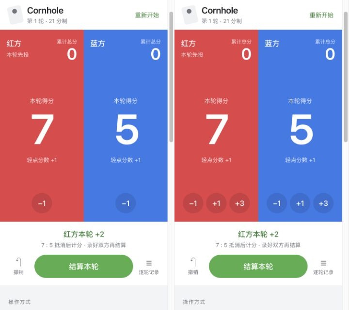

# Cornhole 录分交互原型

入口：[index.html](index.html)。单文件 HTML，CSS 和脚本均内嵌，无第三方依赖，可离线打开。刷新回到初始比分，未接入原生 App 或业务存储。

## 评审操作

- 默认“仅点按”：点本轮大数字 +1，小号 −1 纠错。上方累计总分保持不变。
- 切换“显示加分按钮”：同一比分状态下增加 +1 / +3 按钮，可比较点按成本。
- 双方录好本轮后，点“结算本轮”：计算差额，仅为领先方累计；清空本轮输入，进入下一轮。
- “撤销”回退最近一次录分或结算；逐轮记录包含原始比分、差额归属与累计比分。
- 试用区提供 7:5、12:1、12:0 和从累计 20:18 开始的胜局演示。示例会替换演示比分，可撤销。

## 规则边界

依据 [ACO 官方规则](https://americancornhole.com/rules/)：每方每轮 4 袋，最终留板每袋 1 分、进洞每袋 3 分，双方按轮抵消；整轮结算后累计达到或超过 21 分获胜。打平不加分，并保留原先投方；得分方在下一轮先投。

- 单方原始分合法值：`0,1,2,3,4,5,6,7,8,9,10,12`。11 分不能由 4 袋组成。
- 点按经过 11 时允许继续编辑，显示提示并禁用结算；改为 10 或 12 后恢复。
- 抵消后的净分差可以是 11（12:1），最大为 12（12:0）。
- 0:0 是合法的全未得分轮，可以记录；21 分不要求刚好到达。

## 验证

`node --test docs/demos/cornhole-2026-10-31/scoring.test.cjs`：8 项通过。测试从实际 HTML 载入计分逻辑，并独立枚举 4 袋所有 0/1/3 分组合核对原始分合法性；覆盖抵消、平轮、最大分差、超 21 获胜和已结束状态保护。

浏览器实际点击验证：7:5 结算为总分 2:0；撤销恢复录分；12:1 得 11 分；单方 11 禁止结算；12 上限；+3 快捷键；22:18 胜局；历史记录与撤销胜局；重新开始。

检查 320×568、375×667、667×375、844×390 四种视口，在按钮模式下均无横向溢出，按钮和分数字形未超出所属区域，底部操作区完整可见。浏览器未发现脚本错误。

原始日志、响应式检查 JSON 与截图位于外部测试批次：`~/Library/Developer/jifen-ios-test-artifacts/runs/20261031T014834648299Z-cornhole-prototype-20261031/`，受自动保留期管理，会到期清理。本目录只保留必要的评审对比图。
