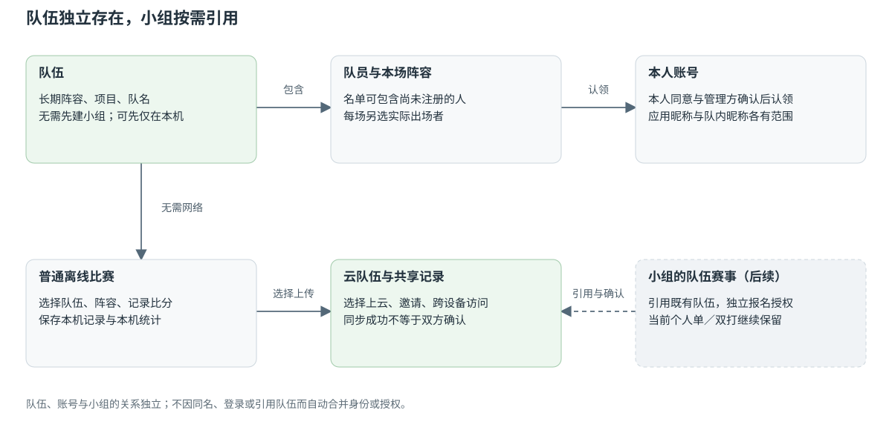
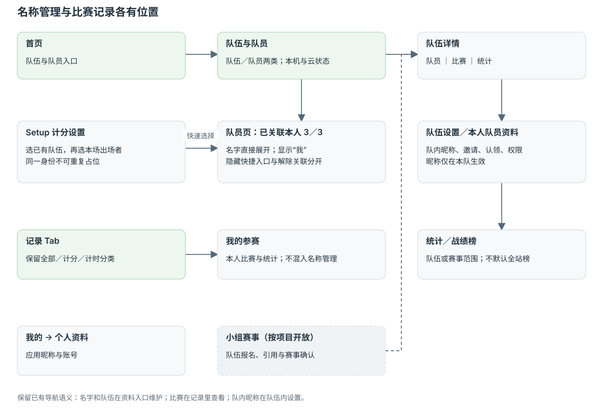
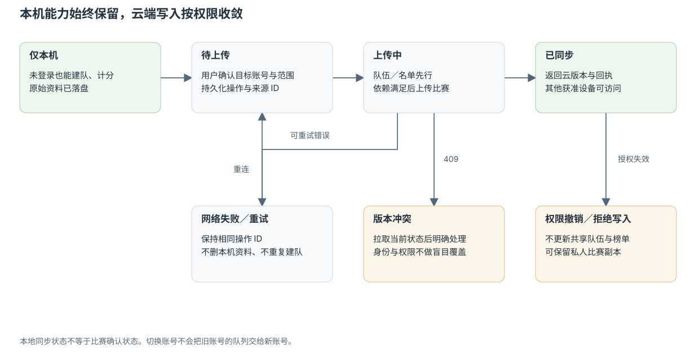
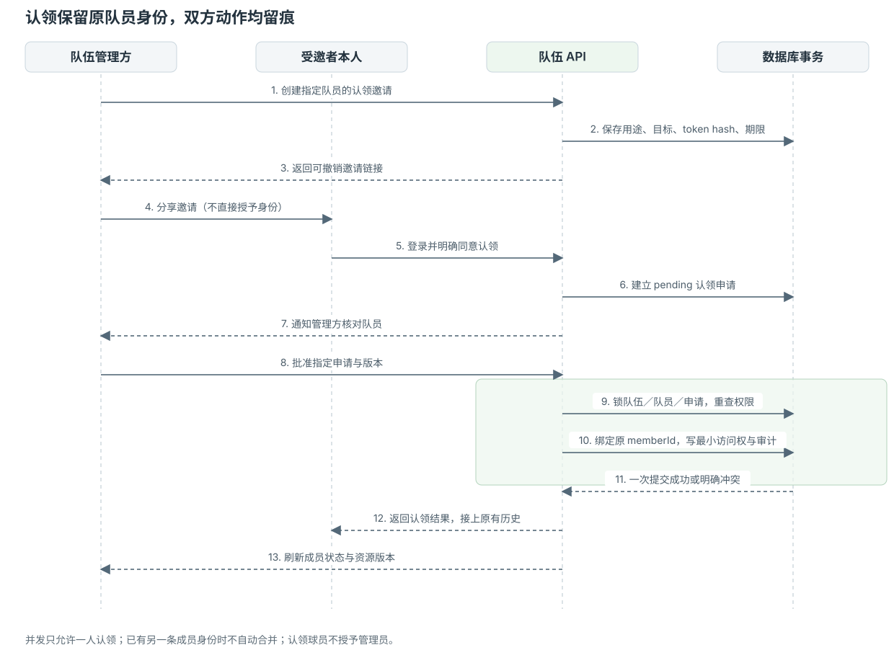
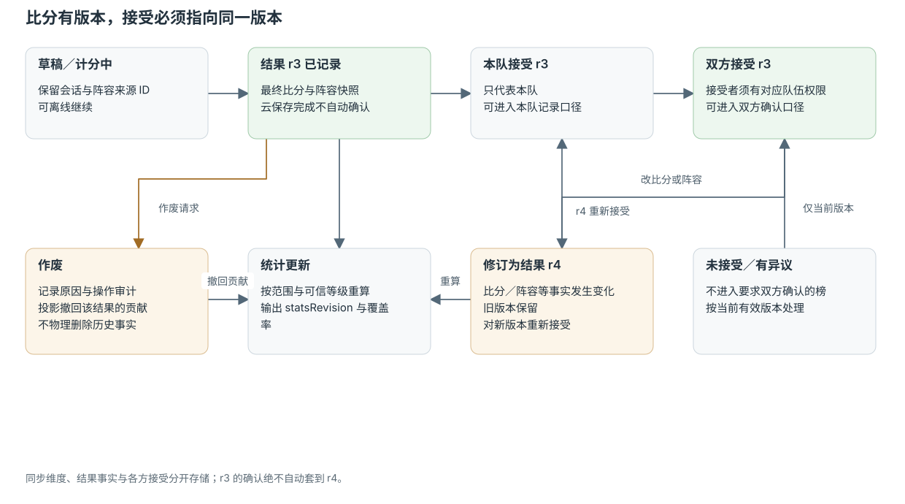
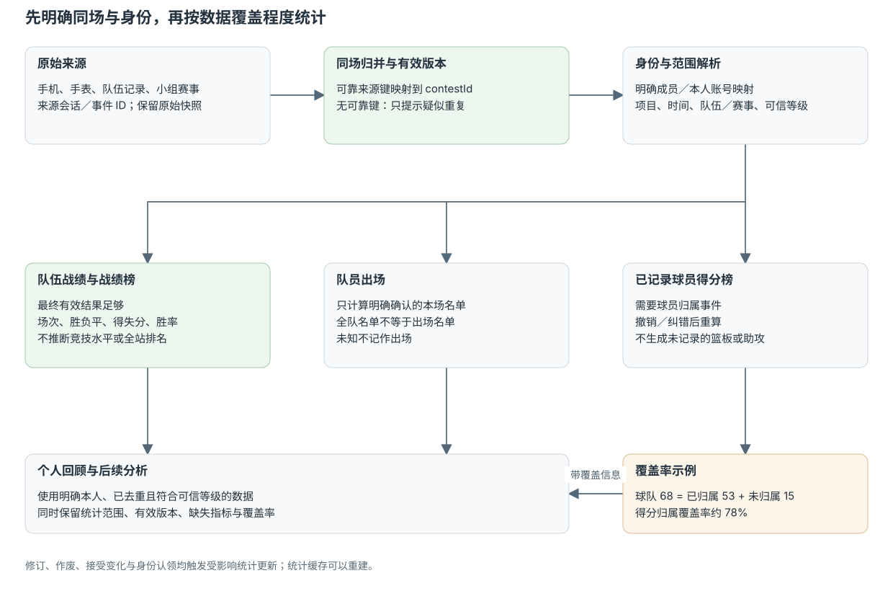
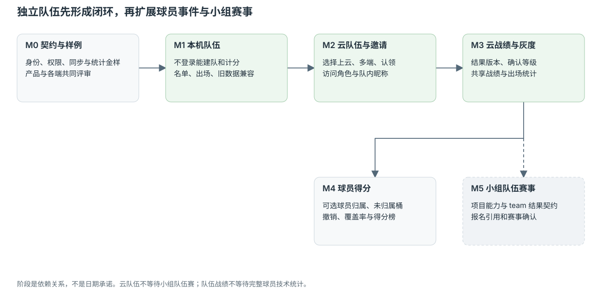

# 独立队伍、队员与云协作 PRD

**版本**：0.1　**日期**：2026-10-24　**状态**：待评审／未实施　**范围**：先统一中文产品概念与跨端行为。

## P01. 产品定义与结论

队伍是一份能持续使用的阵容和比赛资料，不依赖小组存在。用户可以在离线状态下创建队伍、添加未注册队员、选择出场名单、计分并查看本机统计。需要邀请他人、在多设备继续使用、共享队伍资料时，再把选定队伍发布为云队伍。

小组承担活动与赛事组织。需要队伍参赛的项目可引用已有队伍；按个人参赛的项目继续引用个人。加入队伍、加入小组、报名某次赛事是三个独立动作。

**建议中文入口为“队伍与队员”。** “花名册”可用于队内名单的称呼，但不宜作为包含比赛和统计的总入口。本方案不新增一个独立的全局展示姓名。

> 上云不代表公开；绑定本人账号不等于实名认证；组织者不一定是参赛者。

## P02. 问题、证据与目标

### 反馈证据

用户提供的鸿蒙简体中文反馈，创建于 2026-10-09 19:37:24，标题为“队伍里面不能增加人员”；内容指出队伍无法加人，或队员无法分组。反馈状态为待处理。这支持“组织者需要队伍—队员关系”的判断，尚不能单凭这条反馈证明其愿意注册、邀请或使用排行榜。

### 目标与非目标

| 项目 | 本方案要求 |
| --- | --- |
| 组织效率 | 建队后维护固定队员，下一场直接选队伍和本场阵容 |
| 离线可用 | 未登录、无网络时能完成本机创建、选人、计分和查看记录 |
| 身份连续 | 临时队员被本人认领后保留原队员身份与历史，不按姓名重新建一个人 |
| 合作与增长 | 通过邀请，让队员看到本队资料、认领自己并设置队内昵称 |
| 记录可信 | 区分本机记录、本队记录、双方确认与赛事确认 |
| 可计算统计 | 队伍战绩、明确出场次数；有球员记分数据时才生成相应技术榜 |
| 本期不做 | 全国公开排行榜、强制实名、自动抓取通讯录、完整俱乐部经营、通用社交聊天 |
| 保持既有规则 | 不借本项目修改已有小组的人数、会员或计费规则 |

## P03. 已明确方向与本方案建议

### 已明确的产品方向

- 队伍与小组有交集，也各自独立；普通离线计分也要能使用队伍与队员。
- 支持邀请用户加入，用户可以编辑自己在队内的昵称。
- 需要考虑篮球排行榜与长期比赛数据，而不是只增加一个队员名称输入框。
- 当前应用昵称复用既有资料；个人可关联最多 3 个名称；选人时已关联名称显示“我”。
- 一个自然人在同一场比赛中只能占一个个人参赛位置，别名不产生多个参赛身份。

### 建议采用、仍需产品评审的默认方案

- 保留纯本机队伍；上云由用户显式选择，云队伍默认仅对获准成员可见。
- 邀请分为“加入队伍”和“认领已有队员”，两者的权限与确认步骤不同。
- 队伍访问角色与球员名单分离，允许管理员或记分员只组织、不出场。
- 队伍成员变动不改写历史；每场保存当时的阵容和名称快照。
- 队伍战绩先完整支持；球员得分归属作为下一阶段增强；小组队伍赛事再单独接入。

## P04. 核心概念

| 概念 | 含义与边界 |
| --- | --- |
| 队员 | 队伍名单中的一个稳定成员，可以尚未注册。名字相同不代表同一个人 |
| 本人账号 | 登录身份；经确认可对应多个队伍里的不同成员关系 |
| 队伍 | 独立的长期阵容，属于一个运动项目；建议项目创建后不直接修改 |
| 本队访问成员 | 获准查看或管理云队伍的账号；不必同时是出场队员 |
| 本场阵容 | 从队伍名单选择的实际参赛者；加入队伍不等于每场出场 |
| 小组 | 活动、约赛或赛事组织空间；使用队伍时建立显式引用，不复制队伍 |
| 关联名称 | 个人历史数据认领和快捷选人使用的名称，最多 3 个；不代表多个球员 |
| 队内昵称 | 仅在本队生效的称呼，未设置时使用应用昵称；不占个人关联名称名额 |

### 名称显示规则

1. 新队员有账号且设置了队内昵称：优先显示队内昵称。
2. 新队员有账号但未设置队内昵称：使用当前获准展示的应用昵称。
3. 未认领的队员：显示组织者录入的队员名称。
4. 历史比赛始终保留当场名称；“我”的识别以身份关系为准。
5. 管理员给队员的内部备注不得覆盖本人公开的队内昵称；本期可不提供内部备注。

## P05. 页面与入口

| 位置 | 内容与动作 |
| --- | --- |
| 首页 → 队伍与队员 | 替代当前仅存名称的入口，进入“队伍／队员”两类；兼容既有快捷名称 |
| 队伍列表 | 本机／云端状态、运动项目、我的权限；创建、导入、选择上云 |
| 队伍详情 → 队员 | 展开名单、添加队员、邀请加入、认领状态、队内昵称与权限入口 |
| 队伍详情 → 比赛 | 本队比赛、阵容、比分、记录来源、确认状态 |
| 队伍详情 → 统计 | 本队战绩、队员出场；满足数据条件时展示已记录得分榜 |
| 队伍列表 → 战绩榜 | 在明确的项目、时间与记录范围内比较多支队伍，不默认全国排行 |
| 队员页 → 已关联本人 | 直接展开最多 3 个关联名称及操作，不拆成两个“关联／管理”导航行 |
| Setup | 选已有队伍 → 选本场阵容；个人项目直接选人，已关联名称显示“我” |
| 记录 → 我的参赛 | 看本人实际参与的比赛与统计，不把名称管理放在默认内容中 |
| 小组赛事 | 当项目支持队伍时选择已有云队伍，按赛事权限报名；不自动加入队伍或小组 |
| 我的 → 个人资料 | 修改应用昵称，查看本人账号；不设置第三套全局名字 |

当前小组尚不支持篮球、足球队伍赛，此表中的小组队伍赛事是目标位置，不是已上线能力。

### 界面约束

- 名字、“我”、人数、同步／确认状态优先用单行信息表达；完整规则放问号中。
- 关联名称最多 3 个，当前昵称的自动置顶项不额外占名额。计数以明确确认的名称映射去重结果为准，不因改昵称自动增删映射。
- 从选人中隐藏不释放关联名额；解除关联释放名额，但原始比赛不删除。
- 已满 3 个时仍可为已有名称补充旧记录；游客归入账号时对并集再次检查上限。
- 新队伍的数量和名单人数配额另行评审，不套用关联名称的 3 个上限，也不擅自沿用小组配额。

## P06. 关键用户旅程

### FR-01 离线建队并计分（P0）

用户未登录也可创建“飞扬篮球队”，录入队员姓名和可选球衣号。在 Setup 选择飞扬队与另一支本机队伍，选择本场阵容；也允许直接手填对手队名。结束比赛后，原始比分和本场阵容保存在本机。

不要求为了记一场普通比赛先创建小组、先上云、先邀请所有队员。对手只有文字队名时可以计分，但不会自动认作同名云队伍。

### FR-02 选择上云与多端继续（P0）

登录后选择需要上云的队伍。确认页展示目标账号、队伍、队员数、拟上传记录范围。仅上传明确选择的资料，先持久化云队伍与名单，再按依赖上传比赛。

上云成功后保留原本机稳定标识与映射，其他设备能在当前账号权限范围内读取。网络中断可重试，不重复建队、不丢本机记录。登录另一个账号不会接管前一账号的队伍。

### FR-03 邀请加入与认领已有队员（P0）

**邀请加入**：管理员分享队伍邀请，受邀者登录并明确同意；根据邀请策略批准访问，再建立队员身份或关联至已确认的队员。

**认领已有队员**：邀请明确指向原队员，受邀者同意认领后，管理方确认其确为该队员，才绑定原成员身份。认领不是按姓名模糊匹配，也不让链接打开者直接拿走旧战绩。

- 链接可失效、撤销；失效时不暴露整份队员名单。
- 已由其他账号认领：拒绝，交由管理员处理；不覆盖原绑定。
- 同一账号已是另一条队员：提示身份重复，本期不自动合并历史。需要单独的受控合并流程。
- 本人同意与管理方审批均留记录；同一个人重复点击返回同一结果。

### FR-04 阵容、改名、离队与角色（P0）

- 队员可编辑自己的队内昵称；应用昵称、队内昵称和历史快照各有范围。
- 组织者可只做管理员或记分员，不自动占用队员名额，也不自动算作参赛。
- 移出常驻阵容后，以前出场与成绩继续保留；退出访问权限与移出阵容是可区分的操作。
- 移除管理员、队伍归档、邀请撤销等动作，离线时可保存待提交请求，不能在本机先当作云端已生效。
- 同一账号／已确认同一成员在同场多个位置出现时，选人即拦截，提交再校验；同名的不同人允许参加。
- 队员同属比赛双方时，必须明确本场代表哪一队；不能两边都计算个人胜负。

### FR-05 球队比赛与确认（P0）

本机比赛立即可查。上传成功只说明云端保存完成，不等于对手确认。云队伍管理员可记录本队比赛，界面标“本队记录”；对手有权限的确认方也确认当前比分版本，才标“双方确认”。赛事权威确认由未来的赛事契约规定。

同名对手、创建者自报对手账号或本机旧权限缓存，均不能代替对手同意。修订比分要保留前一版本，并使新版本重新进入需要的确认流程。

## P07. 排行榜与统计规则

### 三类能力分开交付

| 能力 | 计算前提 | 明确不能推导的内容 |
| --- | --- | --- |
| 队伍战绩／战绩榜（P0） | 队伍身份、本场最终结果、项目、时间、有效版本与统计范围 | 不能仅凭同名队名合并球队，不能自动变成全国排名 |
| 队员出场统计（P0） | 明确本场出场名单与比赛有效性 | 队伍全名单不等于实际出场名单；未知出场状态不记为已出场 |
| 球员得分榜（P1） | 篮球记分事件明确关联得分球员，能处理撤销与纠错 | 不能从队伍总分反推各人得分；没有篮板、助攻事件就不生成相应榜单 |

### 统计范围与默认口径

- 统计请求必须指定：本机／个人比赛库／本队／某赛事、运动项目、时间范围、最低确认等级、当前有效结果版本。
- 本机与个人记录可先提供战绩表；本队记录显示来源标签。正式赛事排名采用该赛事声明的规则，不偷偷混入友谊赛。
- 普通战绩表默认显示场次、胜／负／平、胜率、总得分／失分和净胜分；排序为胜场、胜率、净胜分，完整展示统计范围与场次。这里不是跨赛事竞技水平评分。
- 胜率为胜场除以有效场次，平局计入分母；是否允许平局由本场规则决定，不能对篮球自定义比赛盲目补加时。
- 足球赛事积分规则可配置，不把 3／1／0 强加到所有运动和所有普通比赛。
- 一场比赛在手机、手表回传、队伍页面、小组赛事出现时，只按明确的同场标识计一次。
- 队伍归档、成员改名或离队不删除有效历史；比赛作废、比分修订和确认撤销要触发重算。

### 球员得分示例

飞扬队总得分 68 分，已明确记录球员归属的得分为 53 分，还有 15 分未归属。界面展示“已记录得分榜”，并显示归属覆盖率约 78%。不能把未知 15 分平均分给上场队员，也不能声称这就是全队完整得分榜。

记分时可选“仅加到队伍”或点选得分队员；为追求完整统计而强制每一球先选人，会阻塞原有快速计分。是否完整记录的开关与说明必须清楚。

## P08. 权限与可见性

| 操作 | 队主 | 管理员 | 记分员 | 已加入的普通队员 | 未认领队员／无权限账号 |
| --- | --- | --- | --- | --- | --- |
| 查看本队共享资料 | 是 | 是 | 是 | 是 | 否；仅可看邀请最小预览 |
| 添加／移出阵容 | 是 | 是 | 否 | 否 | 否 |
| 修改本人队内昵称 | 是，仅本人 | 是，仅本人 | 如本人是队员 | 是 | 未认领时由管理方维护录入名 |
| 创建和提交本队比赛 | 是 | 是 | 是 | 默认否 | 只能在自己的本机库记录，不影响本队榜 |
| 接受本队结果版本 | 是 | 是 | 默认否 | 否 | 否 |
| 邀请、批准认领 | 是 | 是 | 否 | 默认否 | 否 |
| 修改访问角色／转让队主 | 是 | 不可授予队主 | 否 | 否 | 否 |
| 归档队伍 | 是 | 否 | 否 | 否 | 否 |

权限与阵容分开：管理方可以不是球员。队员离队不修改旧比赛快照；离开后停止获取未授权的新资料。队内昵称和名单沿用现有内容审核能力，上云资料默认不公开搜索。

## P09. 旧数据与名称关联

| 旧数据 | 升级方式 |
| --- | --- |
| 一条常用队名 | 升级为可选本机队伍，名单为空；不凭同名自动合并成云队伍 |
| 一条常用个人名 | 保留快捷选择；可创建本机队员或按明确操作归入队伍 |
| 只有文字队名的比赛 | 保留原始名称与比分；提供按名称和明确范围批量关联队伍的工具，不重写原文 |
| 有明确个人位置的旧记录 | 复用个人最多 3 个名称的批量关联；不要求逐场确认 |
| 只有球队总分、无名单 | 可形成已确认归属的队伍战绩，不能形成个人出场或得分数据 |
| 其他账号的资料 | 不跨账号自动迁移，不按同名接管 |

个人关联名称、队伍昵称与队内昵称不是同一额度。队内昵称不占个人 3 个关联名称名额。旧记录关系关联、临时成员认领与账号合并也不能共用一个无差别的“绑定”按钮。

个人名称关联仍属于主对话正在规划的能力；本方案要求共用其身份契约，不假设已经上线或已完成跨端实现。

## P10. 跨端与小组交集

- iOS、Android 各渠道、HarmonyOS、网页与小程序使用同一业务契约；具体端有无完整管理界面，按阶段核对，不要求手表复制全部管理页面。
- 手表／手机联动保留本场队伍、成员及来源比赛标识；没有球员记分能力的设备仍可贡献球队总分，不伪造个人技术数据。
- 现有小组当前仅覆盖羽毛球、乒乓球、网球、匹克球的单／双打。独立队伍先落地；篮球、足球小组赛事需要新的项目能力、队伍报名、可变人数阵容和结果契约。
- 小组引用云队伍需要队伍方和赛事方各自授权；引用队伍不自动让所有队员成为小组成员，也不突破已有小组人数限制。

## P11. 分期与评审门槛

| 阶段 | 交付范围 | 进入下一阶段的条件 |
| --- | --- | --- |
| M0 契约与样例 | 概念、原型、身份与权限、同步错误、统计样例、旧数据样本 | 产品、服务端与各端对同一示例得出一致结果 |
| M1 独立本机队伍 | 队伍／队员、本场名单、离线记录、本机战绩、旧名称兼容 | 不登录可用；升级、改名、换边、撤销不丢身份 |
| M2 云队伍与邀请 | 选择上云、增量同步、访问角色、邀请加入与认领、队内昵称 | 断网重试、并发认领、角色撤销、账号切换和隐私验收通过 |
| M3 云端战绩与灰度 | 有版本的结果、确认等级、共享战绩和出场统计 | 多来源只计一场；修订、作废和撤销可重算 |
| M4 球员得分增强 | 篮球得分归属、未归属桶、事件撤销、覆盖率 | 个人分与未归属分之和等于球队总分 |
| M5 小组队伍赛事 | 扩展项目能力与赛事引用队伍、报名和权威确认 | 不破坏既有单／双打小组；权限与配额隔离 |

阶段顺序是依赖建议，不是开发排期承诺。球队战绩并不依赖 M4 的完整球员技术统计；独立云队伍也不依赖 M5。

## P12. 验收用例

| 编号 | 操作与预期 |
| --- | --- |
| AC-01 | 飞行模式且未登录，创建两队、添加未注册队员、选择阵容并完成比赛；重启后仍可读 |
| AC-02 | 管理员没有加入出场名单，记录比赛后不出现在个人参赛统计 |
| AC-03 | 队员改昵称、离队后查看过去比赛，名字快照与比分不被改写 |
| AC-04 | 选定队伍上云过程中断网，重试不产生第二支队伍或重复队员 |
| AC-05 | A 账号退出并登录 B，不自动把 A 的云队伍或本人关联交给 B |
| AC-06 | 两个账号同时认领一条临时队员，最多一个成功，另一方得到可理解的冲突 |
| AC-07 | 单靠邀请链接、姓名相同或设备缓存权限，不能获得原成员身份或本队管理权 |
| AC-08 | 账号已是另一条队员时认领旧队员，不静默合并；旧数据全部保留 |
| AC-09 | 同一人以不同别名选入同场多个位置，选择与提交均被拦截；同名不同人允许 |
| AC-10 | 队伍 10 人，本场明确 6 人出场，只给 6 人计算出场；未提供名单时记录未知 |
| AC-11 | 手机与手表提交同一来源比赛，战绩只增加一场 |
| AC-12 | 上传成功但对方没确认，显示本队记录，不显示双方确认 |
| AC-13 | 双方确认后修订比分，新结果版本重新确认；旧确认不套用新比分 |
| AC-14 | 得分 68、归属 53、未知 15，个人榜标明范围，覆盖率约 78%，总量守恒 |
| AC-15 | 撤销某球员一次 2 分，队伍总分和该球员有效得分一致减少，不重复扣减 |
| AC-16 | 关联名称达到 3 个时拒绝第 4 个；隐藏不释放额度，解除后可补一个 |
| AC-17 | 本机旧名称迁移不把不同同名队伍合并，不把全部既有队员推定已出场 |
| AC-18 | 没有篮球小组能力的旧端仍可使用原有小组；不把 TeamContest 当 singles 解析 |
| AC-19 | 离线时权限已被撤销，联网提交被拒后，本机原始记录可保留为私人副本，不污染共享榜 |
| AC-20 | 云队伍默认不可被无权限账号搜索和拉取整份队员／比赛数据 |

## P13. 衡量效果与待定事项

上线前记录当前基线，随后观察：建队后添加队员比例、使用已有队伍开始下一场的比例、选定上云完成率、邀请接受／认领完成率、首次看到本人比赛数据的比例、队伍次周继续记分比例、重复比赛与身份纠错率。目标值在基线采集后确定，不虚构增长承诺。

需要评审的事项：新队伍数量／名单人数及免费权益；团队内普通队员是否默认可记分；私人战绩与双方确认榜的默认展示；是否首发支持认领身份的受控合并；篮球球员归属功能的优先级。这些不应通过本技术方案暗中变成既定商业规则。
