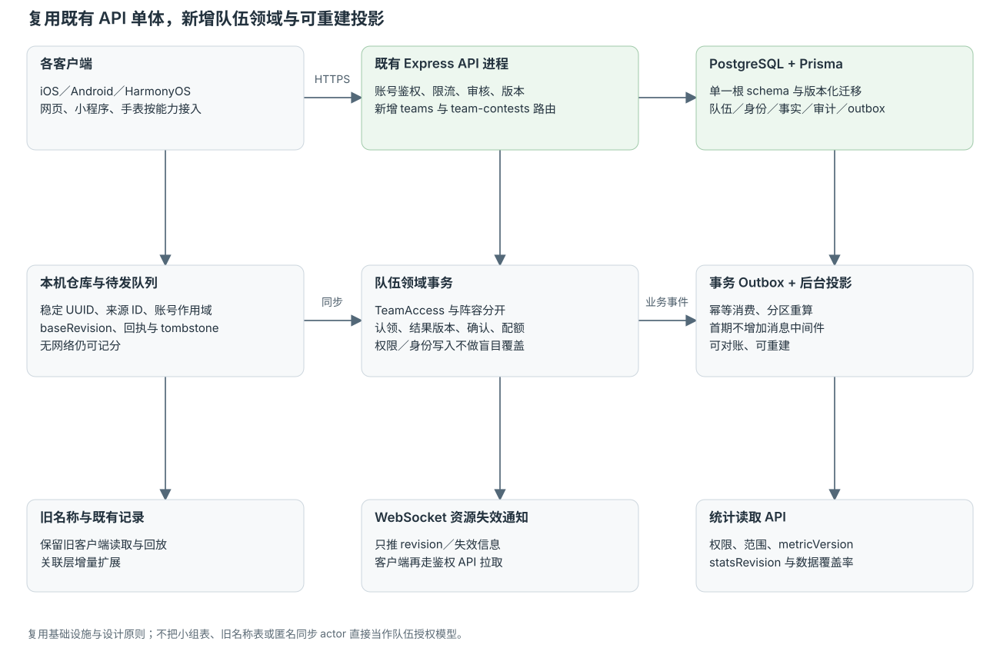
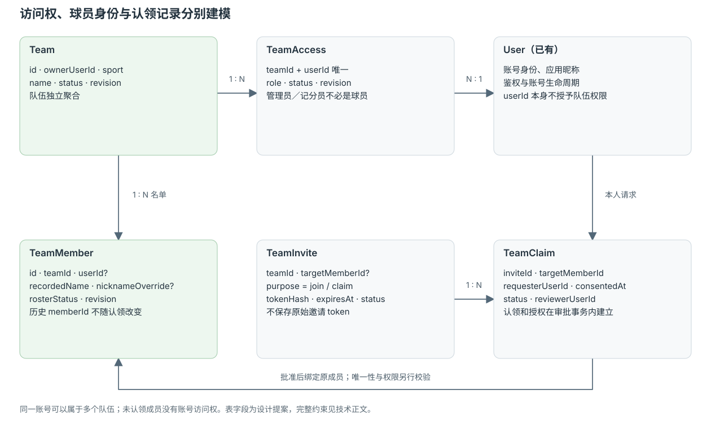
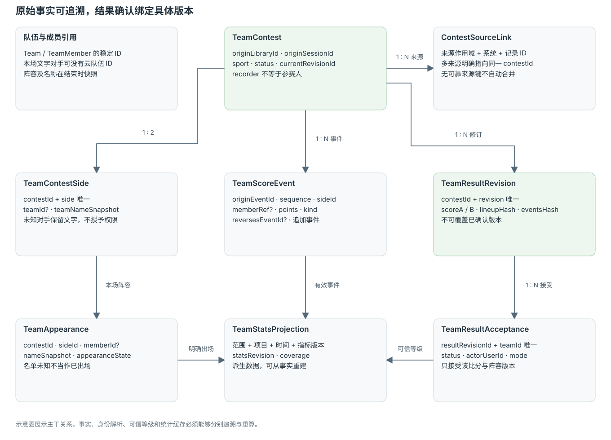

# 独立队伍云协作技术方案

**版本**：0.1　**日期**：2026-10-24　**状态**：设计提案／未建表／未增加接口／未部署。

## T01. 现状核对与改造边界

| 已核对的代码 | 当前能力 | 对本方案的约束 |
| --- | --- | --- |
| 后台根 `package.json`、`api-server/package.json` | Express + TypeScript、Prisma、PostgreSQL，内置 WebSocket | 延续一个 API 进程和根目录单一 schema；不为队伍新建一套微服务 |
| 后台 `prisma/schema.prisma:291` 的 UserCommonName | 账号私有的队名／人名字符串、规范化去重、软删除 | 不能直接当队伍、成员或授权表 |
| 同文件 `ScoreGroup / GroupMember` | 小组、账号或临时成员、成员 ID、权限、快照、历史身份解析 | 可复用设计模式，不能直接复用为“队伍就是小组” |
| 同文件 `GroupGame / GroupResult` | 单／双打、按局赛果、成员席位、确认版本 | 不适合直接装篮球／足球可变人数阵容和总分赛事 |
| `api-server/src/lib/groups/capabilities.ts` | 当前项目仅四种球拍类，format 为 singles / doubles | 小组队伍赛是新能力版本，不是加一个队名字段 |
| `groups/access.ts / idempotency.ts` | 服务端重查权限、版本、锁与幂等回执 | 延用原则，队伍领域使用独立资源锁与错误码 |
| `groups/serializers.ts / service.ts` | 账号队员的部分显示优先使用 user.name，正式成员改名并非现成接口 | 队内昵称要有独立覆盖语义，不能只改客户端文字 |
| iOS `ScoreboardRecord.swift:117` | schema v5，历史名称、动作、比赛快照与来源元数据 | 做增量身份扩展，避免破坏回放和旧版本读取 |
| iOS `RecordSyncOutbox.swift:1` | 有记录发送队列；actor 来自本机匿名身份 | actor 是同步操作者，不等于球员，也不证明云队伍权限 |

以上是本地源码快照核对，不是完整全端审计。正式编码前仍要盘点 Android、HarmonyOS、网页、小程序及各手表项目的序列化、记录同步和未知字段保留行为。

### ADR-01：延续现有单体，新增独立领域

新增 `teams/` 领域服务、路由、投影任务与表；共用既有 User、鉴权、内容审核、幂等基础设施。根 `prisma/schema.prisma` 是唯一 schema 来源。生产使用版本化迁移，不用直接 push schema。此处只提出设计，不修改现有业务文件。



## T02. 核心不变量

1. `teamId / memberId / contestId / eventId` 是稳定身份；名称与屏幕左右位置均不是身份。
2. 未登录本机 ID 不授予云端资源权限；服务端操作者必须来自鉴权中间件。
3. TeamAccess 决定访问权限，TeamMember 决定阵容身份；创建队伍不等于本人出场。
4. 本机队伍发布为云队伍保持 UUID 或有显式、不丢引用的映射；不得按同名合并。
5. 已结束比赛有不可变的阵容、队名和队员名称快照；新版本通过追加修订表示。
6. 同一个确认过的自然人不能在同场占多个个人位置；跨队兼任必须选择本场代表方。
7. 同场去重需要明确来源标识；姓名、时间、比分相同只能是疑似重复。
8. 云端保存状态与结果接受状态分开；同步完成不能伪造双方确认。
9. 邀请 token 不能直接授予既有球员身份；认领必须保留受邀者同意与管理方确认。
10. 排名只计算当前有效结果版本，撤销／作废／认领变化均可重算；不覆盖事实日志。

## T03. 领域数据模型

### 队伍、权限与成员

| 表（拟新增） | 关键字段 | 约束与含义 |
| --- | --- | --- |
| Team | id UUID、ownerUserId、sport、name、status、revision、createdAt、archivedAt | 独立聚合；sport 初期不可直接改；本机所有权发布后由服务端建立 |
| TeamAccess | teamId、userId、role、status、revision、grantedBy | 唯一(teamId,userId)；角色 owner/admin/recorder/member，与是否球员分离 |
| TeamMember | id、teamId、userId?、recordedName、nicknameOverride?、jerseyNumber?、rosterStatus、revision | memberId 保持不变；userId 仅经批准认领后设置；同队同一账号最多一条有效球员身份 |
| TeamInvite | id、teamId、purpose、targetMemberId?、tokenHash、expiresAt、status、invitedBy | purpose=join/claim；原始 token 不落库；目标和用途不可被受邀者替换 |
| TeamClaim | id、inviteId、teamId、targetMemberId、requesterUserId、consentedAt、status、reviewerUserId?、reviewedAt | pending/approved/rejected/cancelled/expired；审批使用事务锁，完整审计 |
| TeamAuditLog | actor、teamId、resource、action、beforeRevision、afterRevision、reason、createdAt | 权限、认领、角色、归档、结果修订的追加审计 |

`nicknameOverride = null` 明确表示跟随应用昵称；有值表示队内独立称呼，不靠与 user.name 是否相等来判断。`recordedName` 保留未认领成员及管理录入的基础名称；账号昵称审核通过前按既有展示策略解析。

同账号有多队身份是允许的。不同本机库里同名队员不会自动变成一个全局“真实的人”。跨队个人统计只沿已确认的账号关系解析；私人名称关联不会生成 TeamAccess。

已退役的名单与已离开的访问成员分别留状态。若一个账号需要恢复原队员，优先恢复既有成员身份，不能靠新建第二条绕过唯一性。涉及两条历史成员合并的情况，本期返回冲突并保留数据，后续建立明确审批合并流程。



### 比赛、阵容与结果

新表使用 `TeamContest`，避免与已有实时 `Match`、个人小组 `GroupGame` 混淆。

| 表（拟新增） | 关键字段 | 约束与含义 |
| --- | --- | --- |
| TeamContest | id、originLibraryId、originSessionId、recorderUserId?、sport、status、playedAt、currentRevisionId、lineupCompleteness、rulesJson | draft/finished/voided；名单完整性 unknown/partial/complete；来源键稳定唯一 |
| TeamContestSide | id、contestId、side A/B、teamId?、localTeamRef?、teamNameSnapshot | 唯一(contestId,side)；文字对手允许 teamId=null，不自动绑定同名云队伍 |
| TeamAppearance | id、contestId、sideId、teamMemberId?、guestParticipantId?、nameSnapshot、appearanceState | confirmed/unknown/did_not_play；确认出场才计数，不复制整个常驻阵容作为出场 |
| TeamScoreEvent | id、contestId、originEventId、sequence、sideId、memberRef?、kind、points、reversesEventId?、createdAt | 追加事件；memberRef=null 表示未归属；唯一来源事件防重复 |
| TeamResultRevision | id、contestId、revision、scoreA、scoreB、outcome、lineupHash、eventsHash、status、reason | 唯一(contestId,revision)；不可原地修改已确认版本；保留已作废版本 |
| TeamResultAcceptance | contestId、resultRevisionId、teamId、status、actorUserId、mode、acceptedAt | 唯一(resultRevisionId,teamId)；pending/accepted/disputed/revoked；接受必须绑定版本 |
| TeamStatsProjection | scopeType、scopeId、sport、periodKey、identityKey、metricVersion、statsRevision、payload | 派生缓存，不是事实来源；可完整重建 |
| TeamDomainOutbox | eventId、aggregateId、revision、type、payload、status | 与业务写同事务，后台任务可重放、幂等消费 |

个人队员身份不能与账号权限混用。TeamAppearance 引用成员或本场临时身份，结束后保留快照；成员后来认领时，身份解析器通过原 memberId 找到账号，不重写历史名字。



### 后续小组桥接

新增 `GroupTeamEntry(groupId, teamId, seasonOrActivityId, status, teamApprovedBy, groupApprovedBy, revision)` 作为显式报名／引用。小组需新增 team 赛事能力与相应结果适配，既有 singles/doubles 枚举的旧分支保持可读。

报名引用队伍不自动插入全部 GroupMember，不改变小组既有计数与配额。是否允许名单中的非小组成员参赛，由新的队伍赛事规则明确，不能借桥接默认放开旧权限。

## T04. 本地存储与同步协议

### 本地层

各端增加队伍、访问快照、成员、邀请状态缓存、阵容引用、结果版本与待发送操作。可复用现有记录队列的基础能力，但队伍操作必须有自己的聚合版本和权限错误处理。

| 元数据 | 用途 |
| --- | --- |
| localLibraryId | 区分未登录本机资料范围，不作为云端授权凭据 |
| aggregateId / clientOperationId | 创建前本机生成的稳定 UUID；重试不重新生成 |
| baseRevision | 提交时检查云队伍版本，拒绝盲目覆盖 |
| originSessionId / originEventId | 手机、手表、恢复会话与回传的稳定来源标识 |
| syncState | local_only / queued / syncing / synced / conflict / rejected |
| accountScope | 本次操作显式属于哪个登录账号；切账号冻结不属于新账号的队列 |
| deletedAt / tombstoneRevision | 防止旧客户端和迟到请求恢复已移除数据 |

### 选择上云

1. 客户端先显示所选队伍、成员、旧记录范围与目标账号，收集明确同意。
2. 上传计划分配稳定 `clientOperationId`，队伍和名单作为一个有界聚合创建；成员 UUID 一并保存或返回映射。
3. 服务端鉴权、校验 UUID 未被其他所有者占用、限额与文本审核，事务创建 Team、TeamAccess、TeamMember、幂等回执和 outbox。
4. 成功后本机保存回执，再按依赖上传选择过的比赛；只在持久化确认后出队。
5. 未完成部分保留待发送状态；失败不删除原始本机队伍。不会自动上传所有个人库或认定所有名单成员都已注册。

### 多端增量与冲突

- 初次拉取是授权快照加 cursor；增量是服务端顺序变更流，cursor 不使用设备时钟。
- `POST /api/teams/sync/push` 按操作返回 applied/conflict/rejected 和当前 revision；单个资源写入原子，整批允许部分成功，并报告依赖失败。
- 关系操作、删除、访问角色与认领禁止最后写入覆盖；遇到版本不一致返回 409，用户决定重新提交还是保留私人副本。
- 队内昵称可以按资源版本重试；不把本地旧值覆盖管理方已确认的身份或恢复已删除成员。
- 权限被撤销后，旧缓存可用于理解本机历史，但不能继续拉取云端新数据。待提交云写入拒绝后可另存私人记录，不能复制云授权。
- WebSocket 仅发送资源失效／revision 提示；客户端必须通过带鉴权的 API 拉取，不把敏感整份阵容直接广播给所有会话。

## T05. 邀请、认领与权限事务

### 邀请令牌

使用高熵、带用途的随机 token，服务端只存 hash。建议默认有效期 7 天、单人认领链接单次完成后失效；具体有效期可配置。普通多人加入链接与指向既有成员的认领链接分开。公开预览只给队名、项目、邀请用途与必要提示，不返回完整名单、账号标识或统计。

### 认领事务

审批锁顺序固定：Team → TeamMember → TeamClaim → requester 对应访问关系。事务内重新检查：账号有效、队伍有效、审批者当前角色、邀请用途与目标、受邀者同意状态、成员未被其他人绑定、同队账号唯一性、请求版本。通过后绑定原成员 userId，按明确策略创建最小 TeamAccess，写审计和 outbox。业务写入、幂等回执与 outbox 必须使用同一个数据库事务对象，不能在幂等回调中另起独立事务。

认领一个球员不授予管理员角色。已有其他成员身份时返回 `ACCOUNT_ALREADY_HAS_TEAM_MEMBER`，不自动把另一条球员改成当前人，也不通过姓名合并跨队身份。并发审批一人成功，另一人收到冲突；请求重放返回首次结果。

### 队主与访问控制

队主可不是球员，但必须是有效账号。队主转让需要目标账号已明确同意并有有效访问关系；不可留下没有负责人的云队伍。删除本人账号、队伍归档与解散复用现有账号生命周期框架，但需要单独的队伍数据保留／匿名化策略，不复制全部小组逻辑。

## T06. 拟新增接口

以下均为提案路径，不是现有线上 API。所有共享写入都使用鉴权、幂等键与适用的 If-Match；列表分页使用不透明 cursor。

| 方法与路径 | 用途与关键约束 |
| --- | --- |
| GET `/api/teams/capabilities` | schemaVersion、项目、角色动作、暂定配额、同步与球员事件能力 |
| GET / POST `/api/teams` | 列出有权访问的云队伍／从明确选定的本机队伍创建 |
| GET / PATCH `/api/teams/:teamId` | 获取／更新队伍，版本匹配；修改 sport 初期拒绝 |
| GET `/api/teams/:teamId/access-members` | 当前访问成员与可见角色，不等于球员名单 |
| PATCH `/api/teams/:teamId/access-members/:userId` | 队主调整已加入者的角色／访问状态；不能用此接口静默添加未同意账号 |
| POST `/api/teams/:teamId/leave` | 本人退出访问与后续通知；当前队主须先转让或按规则归档 |
| POST `/api/teams/:teamId/owner-transfers` | 发起转让，记录目标与其接受状态；尚未接受不换队主 |
| POST `/api/teams/:teamId/owner-transfers/:id/accept` | 目标账号明确接受后，事务更新唯一队主与角色 |
| POST `/api/teams/:teamId/archive` | 队主归档，保留只读历史与统计，不物理删队 |
| GET / POST `/api/teams/:teamId/members` | 阵容分页／新增未认领队员，不替对方注册账号 |
| PATCH `/api/teams/:teamId/members/:memberId` | 修改录入信息或阵容状态；本人昵称和管理录入名使用不同动作白名单 |
| PATCH `/api/teams/:teamId/me/nickname` | 本人队内昵称；null=跟随应用昵称；沿用审核策略 |
| POST `/api/teams/:teamId/invitations` | join/claim 两种用途，claim 必须绑定 targetMemberId |
| GET `/api/team-invitations/preview` | token 最小预览，限流；不返回整份名单 |
| POST `/api/team-invitations/accept` | 登录本人同意加入或认领，操作幂等 |
| GET `/api/teams/:teamId/claims` | 管理方处理认领申请；仅返回其有权管理的范围 |
| GET `/api/team-claims/:claimId` | 请求人或授权管理方读取申请状态 |
| POST `/api/team-claims/:claimId/withdraw` | 本人在审批完成前撤回，审批事务必须检查未被撤回 |
| POST `/api/teams/:teamId/claims/:claimId/approve` | 管理方确认，执行身份／权限事务 |
| POST `/api/teams/:teamId/claims/:claimId/reject` | 明确拒绝与原因；保留审计 |
| POST `/api/teams/:teamId/invitations/:id/revoke` | 撤销尚未完成的邀请 |
| POST `/api/teams/sync/push` | 操作批次、依赖、baseRevision、逐项回执 |
| GET `/api/teams/sync/pull?cursor=...` | 当前账号授权资源增量与撤销通知 |
| POST `/api/team-contests` | 有权限范围内创建比赛，保留来源同场键 |
| GET `/api/teams/:teamId/contests` | 本队可见的比赛与当前结果版本分页 |
| GET / PATCH `/api/team-contests/:id` | 按权限读取／更新可写草稿；已结束结果改走追加修订 |
| POST `/api/team-contests/:id/events/batch` | M4 球员事件与撤销批次，独立来源事件键与逐项回执 |
| POST `/api/team-contests/:id/results` | 提交新结果版本，不覆盖旧已确认版本 |
| POST `/api/team-contests/:id/revisions/:rev/accept` | 代表有权限队伍接受指定版本，不能代表对手 |
| POST `/api/team-contests/:id/revisions/:rev/dispute` | 不接受该版本，停止其进入需要双方确认的榜 |
| POST `/api/team-contests/:id/void` | 作废并留原因，发布重算事件 |
| GET `/api/teams/:id/statistics` | 本队统计，必须声明范围、确认等级、metricVersion 与 statsRevision |
| GET `/api/team-rankings` | 当前账号有权查看的指定队伍集合／赛事战绩；不是全站裸查询 |

建议统一错误形状：`{ error, message, resourceId?, currentRevision?, retryable?, details? }`。明确区分 401 未登录、403 无权动作、404 不可见资源、409 版本／身份冲突、422 不合法阵容／比分、429 限流。对不应泄露存在性的资源沿用不可见即未找到的策略。

### 提交结果示例

```json
{
  "clientOperationId": "019d-demo-operation",
  "originSessionId": "019d-demo-match",
  "baseRevision": "12",
  "sport": "basketball",
  "score": { "A": 68, "B": 61 },
  "sides": [
    { "side": "A", "teamId": "team-feiyang", "teamNameSnapshot": "飞扬队" },
    { "side": "B", "teamId": null, "teamNameSnapshot": "晨光队" }
  ],
  "lineupCompleteness": "partial",
  "appearances": [
    { "side": "A", "memberId": "member-001", "nameSnapshot": "小杨", "state": "confirmed" }
  ],
  "rules": { "schemaVersion": 1, "allowsDraw": false },
  "scoreAttribution": { "attributedPointsA": 53, "unattributedPointsA": 15 }
}
```

上例 ID 为便于阅读的示意占位，正式接口使用约定 UUID。此例仅展示一名已确认出场者，故名单标为 partial，不能据此认定完整球队阵容。归属合计与差额由服务端从有效事件和结果核对／计算，不能信任客户端自报汇总。没有 B 队 ID 时，不创建 B 队访问权，也不产生双方确认。

## T07. 比赛事实、接受状态与统计投影

### 来源身份与去重

本机开始比赛即生成稳定 `originSessionId` 和受保护的来源作用域；手机、手表与小组回传必须保留原始同场键。客户端各自的记录 ID 通过 `ContestSourceLink(originNamespace, sourceSystem, sourceRecordId, contestId)` 关联同一场，前三者组成唯一键。来源作用域由服务端验证归属，不能任意指定别人的库；两台设备都使用局部记录号“1”也不会撞在一起。旧数据没有可靠同场键时，不自动用“同名＋同分＋相近时间”合并；只提示疑似重复。

### 权威事实与可信等级

- TeamContest 的当前有效结果版本是比分事实；TeamResultAcceptance 表示各方对这个版本的接受，不混入同步状态。
- 本队记分员可以提交本队记录，但默认不能代表双方确认；队伍管理员仅代表本队接受。
- 私人库看到同名云队伍不自动把该结果写入对方共享榜。对方进入后必须有明确比赛引用与本队接受。
- 结果 r3 的接受不适用于 r4。修改比分、阵容或会影响统计的规则产生新版本，相关接受重新建立。
- 作废不物理删除事实；统计投影收到相应修订事件后撤回旧贡献、应用新贡献，或对受影响分区全量重算。

### 投影与一致性

首期采用同一 PostgreSQL 内的事务 outbox 与幂等后台任务，不预先引入独立消息中间件。消费键为事件 ID，统计分区含 scope、sport、period、metricVersion；同一聚合修订只应用一次。

对外响应包含 `resultRevision / statsRevision / computedAt / coverage`。结果已保存但投影仍在处理时，显示“统计更新中”，不使用旧榜伪装已更新。支持后台按范围重建并核对校验和。

### 球员事件数据

篮球加分事件至少有球队、分值、来源事件 ID、可选球员、序列号。撤销追加 reversal 引用原事件；纠错追加修订，不把原事件原地变成另一名球员。未归属得分单独计算；没有统计的项目返回缺失，不返回 0 冒充真实测量。

比赛最终总分与动作合计不一致时，保留结果摘要并标明事件覆盖不足；如用户选择完整技术统计模式，应在结束前提示差异，不能偷偷把差额分摊给球员。

## T08. 兼容迁移与逐端落地

### 数据迁移

采用“新增表／可选字段 → 服务端能力目录 → 新端增量读写 → 小流量验证 → 扩展入口”的顺序。旧常用名称仍可读写；新队伍数据通过独立存储和接口维护，不把成员关系塞进旧 name 字符串或 UserCommonName.type。

旧名称升级本机队伍时建立 `LegacyNameEntityLink(ownerScope, type, normalizedName, localEntityId, migrationBatchId)`，同名只是用户明确确认的迁移范围，不跨用户去重。原始记录与回放不改写，身份关系另存。

已有计分引擎的 `team_0 / team_1`、左右席位和 winner identity 仍然表示比赛内部的位置，不替换成云队伍 ID。新增可版本化的 roster context，在位置之外保存 teamId、memberId、当场名称和来源会话；需要时作为独立 sidecar 随记录关联。显示层换边不会交换自然人身份，也不会重新分配云队伍 ID。

### 客户端能力

| 客户端 | 必须核对／改造 |
| --- | --- |
| iOS / Android / Android Google / HarmonyOS | 名称兼容、本机队伍仓库、访问与成员模型、离线队列、版本冲突、选队与出场、记录来源 ID |
| 网页 / 小程序 | 接受邀请、登录回跳、最低权限名单、队内昵称、读取与可选记分；能力不足时不写未知新版实体 |
| 手表独立端 / 手机联动 | 队伍与成员引用、来源会话和事件 ID、可选得分归属；手机可承担完整管理与认领 |
| 后台管理端 | 队伍与身份审计、内容审核、争议查看、投影重建、邀请撤销与异常认领排查 |

不能仅靠“可选字段”保证兼容：如果旧端解码再编码会丢未知字段，要用 sidecar 存储或服务端合并保护新关系，绝不允许旧快照覆盖新身份、权限和 tombstone。

### 小组对接阶段

新增小组项目能力版本、team 赛制、队伍报名与结果适配，服务端按 capabilities 检查；不认识 team 的旧端只读提示升级，不把人数压成 singles/doubles。保留既有组长、成员、确认和人数语义。

## T09. 权限、内容与运维

- 所有共享写入重查账号、TeamAccess、队伍状态、资源归属和版本；不信任客户端提交的 owner、role、reviewer 或 confirmedBy。
- 私人备注、账号联系方式不随队伍整包暴露；邀请预览只给完成当前动作所需信息。
- 沿用既有文本／头像审核框架，新增队伍、队内昵称审核目标和范围；本地录入与对外共享的状态明确分开。
- 对邀请创建、预览、接受、认领与同步有分层限流；配额由 capabilities 下发，尚未确定的商业配额不在客户端写死。
- 日志不写原始邀请 token、登录凭据和整份个人资料。审计保留动作与资源 ID，用于纠错与追溯。
- 监控队列积压、409 比例、认领冲突、拒绝越权、重复比赛、投影延迟、事件总量守恒和重算差异。
- 队伍归档、退队、账号注销、隐私删除的产品保留期仍需专项评审；不可通过级联删除摧毁他人合法持有的历史比赛快照。

## T10. 验证、上线与回退

| 类别 | 必测项 |
| --- | --- |
| 单元／属性测试 | 名称规范化、身份查重、计数上限、统计范围、事件撤销和未归属分守恒 |
| 数据库集成 | 同 key 重放、不同 body 复用 key、并发认领、账号同队唯一、事务失败回滚、权限撤销与 tombstone |
| 同步回归 | 断网／重试／换账号／旧版本回写／乱序事件／同场多来源／部分批次失败与依赖 |
| 统计金样 | 本队记录与双方确认分开；r3→r4 不继承确认；作废撤回；离队改名不改变快照 |
| 端到端 | 未登录离线建队、选择上云、邀请认领、本人昵称、球员出场、旧名批量关联与原记录保留 |
| 跨端契约 | 同一份 JSON 样本在所有参与端解码、重编码、恢复、上传后身份不漂移 |

推荐依 feature flag 分别控制：本机队伍、云发布、邀请认领、共享战绩、球员事件、小组 team 赛事。先在内部账号验证，再有限灰度。上线前比较迁移样本数量、成员引用完整性与统计金样；按照各端既有发布门槛完成设备回归。

回退优先关闭新写入和新入口，保留已生成资料的只读能力。数据库采用向前兼容的新增结构，不以删表或清空新字段回退；队列与 outbox 保留，恢复后可幂等继续。

## T11. 评审必须回答的问题

| 问题 | 本方案建议／仍需确认 |
| --- | --- |
| 新队伍商业配额 | 尚未确定；独立评审，不改变既有小组规则 |
| 普通队员能否提交本队比分 | 默认否；明确授权为记分员后可提交，仍不能代表对手确认 |
| 认领冲突时是否自动合并 | 不自动；首期保留冲突并交由管理方处理，完整合并为后续能力 |
| 队伍战绩默认可信等级 | 私人／本队显示明确来源；正式赛事排名使用该赛事要求 |
| 队内昵称审核策略 | 复用现有框架，新增队伍作用域与本人预览语义；与现有服务端解析统一 |
| 篮球球员得分优先级 | 作为 M4，先不承诺篮板、助攻等未记录指标 |
| 小组队伍赛上线时间 | 在独立队伍稳定后单独立项，不假定当前已支持篮球、足球 |

技术方案以这些默认约束形成可评审基线；它不替代上述产品决策，也不表示现有后台已经提供所列能力。
