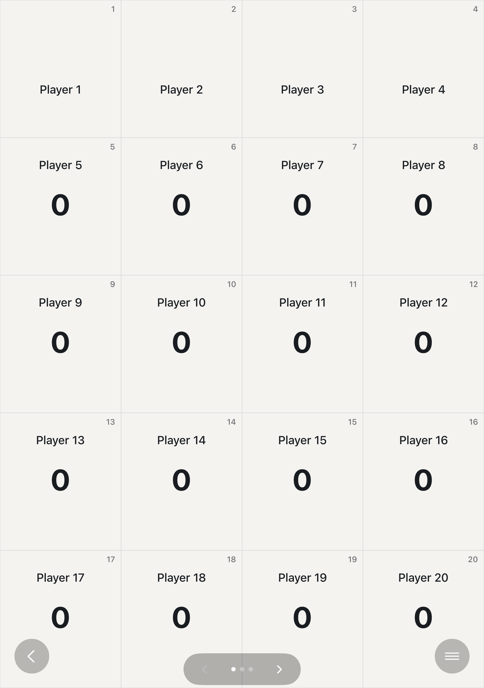
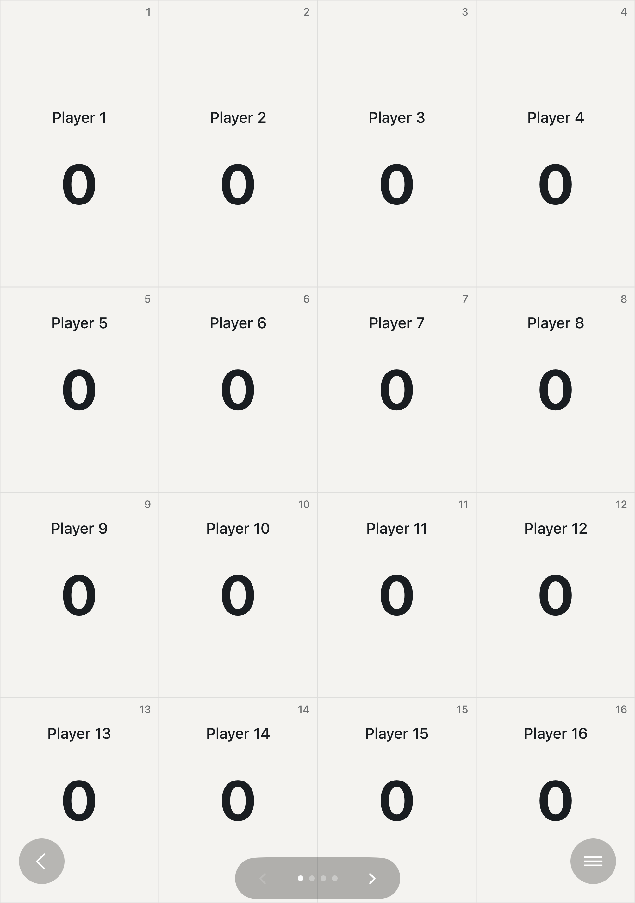
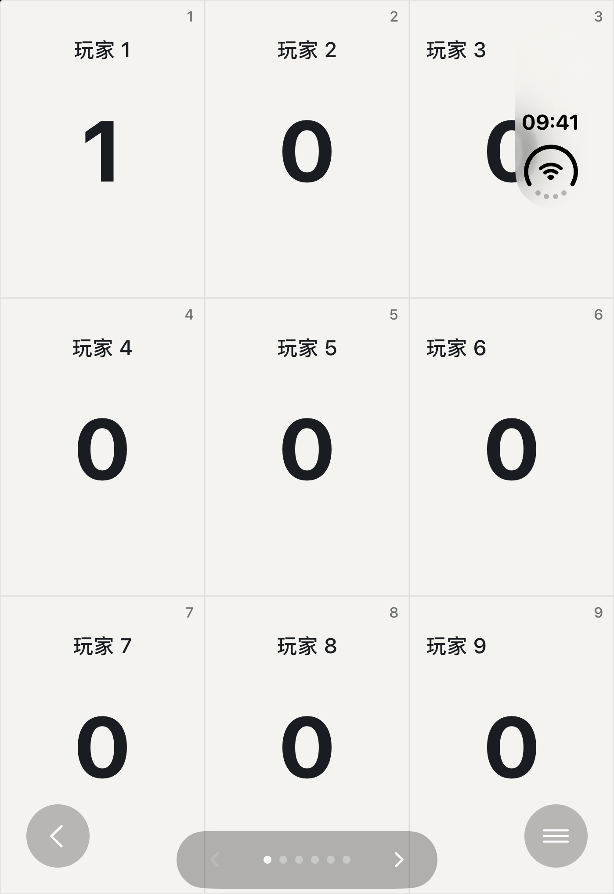
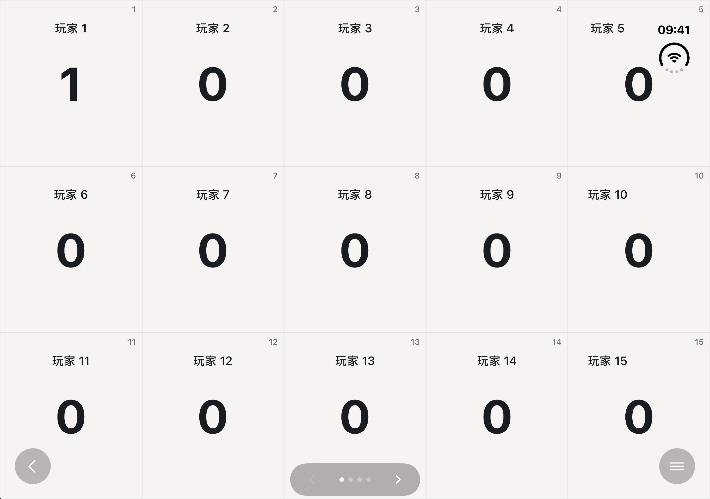
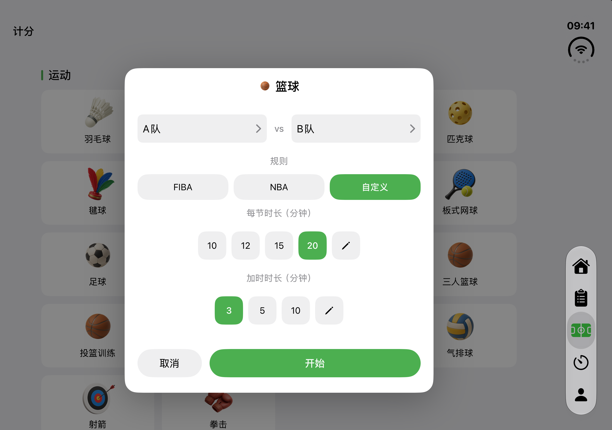
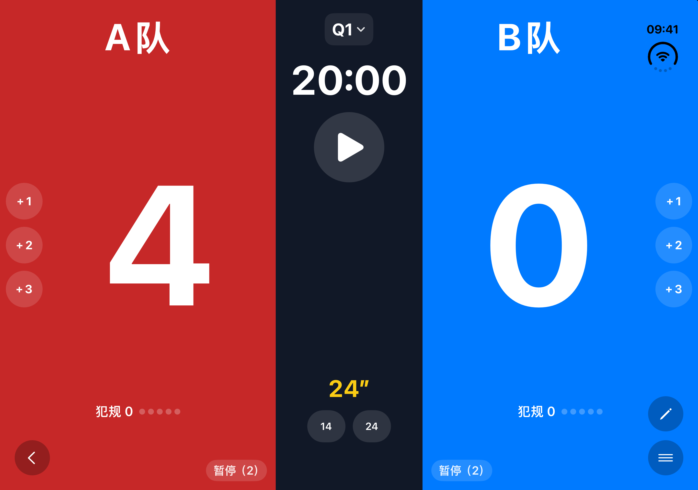
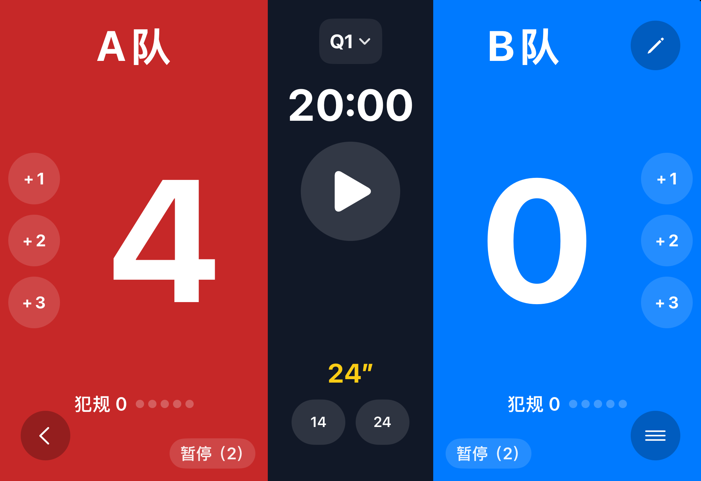
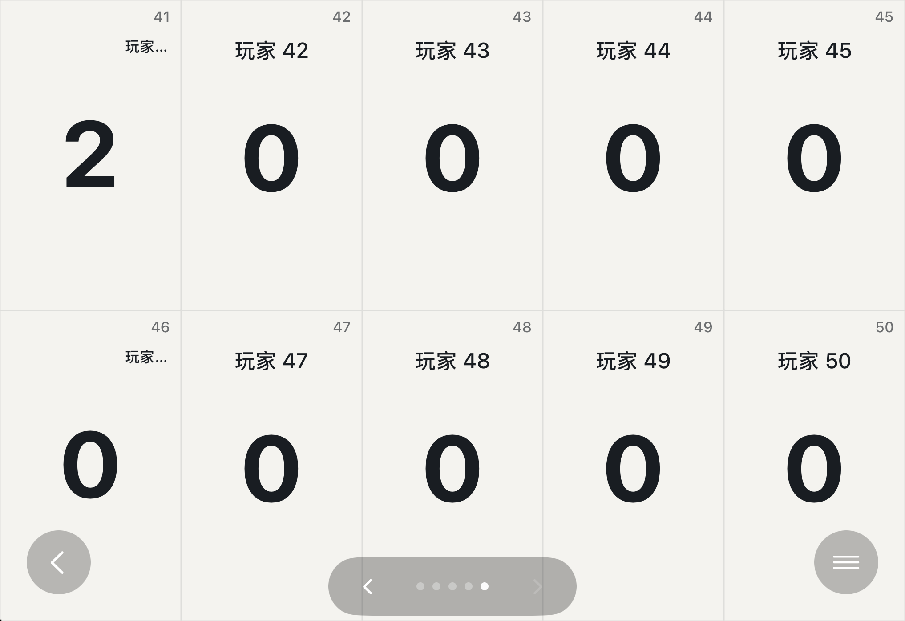
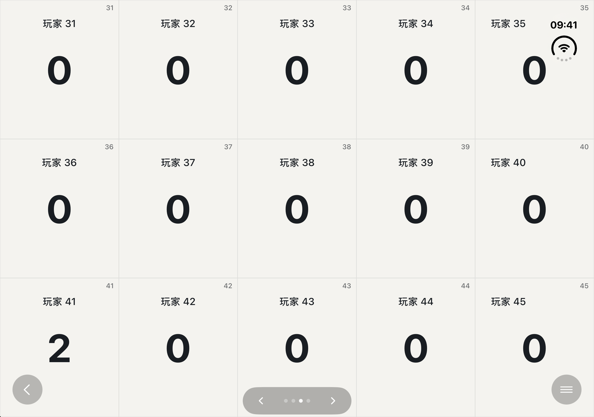
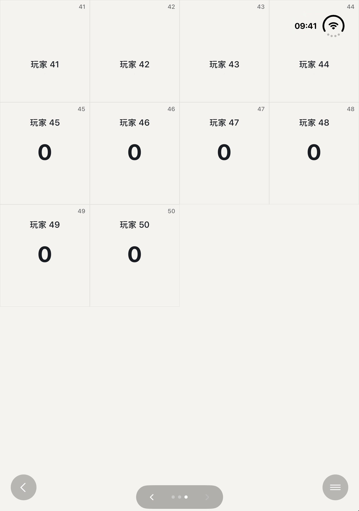

# iPhone Duo 发版前验证

2026-10-31，iPhone Duo / iOS 27.1 Simulator。用户指定本轮可用 Duo 做折叠验收。**篮球通过；多人首行比分异常已完成复现、修复和回归，实际 Open→Closed→Open 通过。** 初查图片与结论作为历史记录保留，不再代表当前修复包。

## 多人首行问题修复前后

在真正的 `MultiScoreboardView` 中，使用相同 669×951 pt 竖向窗口及 86 pt 顶部安全区，旧布局首行比分缩至 1 pt；修复后先按安全内容空间计算分页，再将首行背景延伸到顶部。各行比分使用相同内容高度，首行可读。以下是受控原生视图对比，不冒充实际折叠截图。

| 修复前：首行比分不可见 | 修复后 |
| --- | --- |
|  |  |

Duo 定向 12 项通过，包括 11 项分页/字号测试和 1 项原生视图的竖→横→竖窗口变化审查。11 项也在全量单测中覆盖，不重复累计。

## 修复后的实际开合

新的 UI 用例通过：194.066 秒，6 张原图。实际给第 1 位玩家加至 1 分，切换布局、查看第 50 位玩家并返回，再由 Device Hub 真实切换 Open→Closed→Open；比分仍为 1，首四位比分可达，文本高度至少 24 pt。

| 新外屏 | 新内屏 |
| --- | --- |
|  |  |

原图按实际显示面 UUID 获取。当前 Duo 的 AX 尺寸、API 请求方向和真实像素方向有时不一致，所以不以 AX 尺寸单独声称旋转成功；布局菜单切换和实际 Device Hub 开合分别核对。CUA 仅用于模拟器开合，商店的全部操作使用 API。

## 篮球

篮球用例通过真实 Device Hub Open / Closed 切换完成，6 张原始图中精选 3 张：赛前设置 20 分钟每节、3 分钟加时，开合后生效；进入计分板后保持 20:00 和 4 分，实际打开编辑确认没有修改时长入口。

| 赛前内屏 | 比赛内屏 | 比赛外屏 |
| --- | --- | --- |
|  |  |  |

## 初查历史

较早的多人长流程未完整跑通，未计为通过，原不稳定用例已移除。初查改用 CUA 操作 Device Hub：50 人草稿恢复后，外屏末页 41～50，41 号加至 2 分；展开横屏及合上仍为 2 分。以下是修复前的手工原图。

| 外屏末页 | 展开横向内屏 |
| --- | --- |
|  |  |

当时另一次展开进入竖向内屏，首行 41～44 号比分不可见；后续已用安全区复现并修复，见[原始异常及后续闭环](multi-open-portrait-anomaly.md)。

`selected-screenshots.json` 保留文件来源、SHA-256 和手工图的显示屏 UUID。截图为运行中应用的完整原图，未拼接或修改 UI。按姿态选择内/外屏，不使用可能滞后的 AX `app.frame` 判断。

初查原始证据位于 `/Users/yangyang/Library/Developer/jifen-ios-test-artifacts/runs/20261031T022812187319Z-ios-341-preflight-20261031/`；复现、修复和最终回归位于 `/Users/yangyang/Library/Developer/jifen-ios-test-artifacts/runs/20261031T043106001243Z-duo-multiscore-safearea-fix-20261031/`。异常解决后，解除初查批次的 `.keep`，两批证据按临时保留策略到期。此目录仅保留必要截图与结论。
