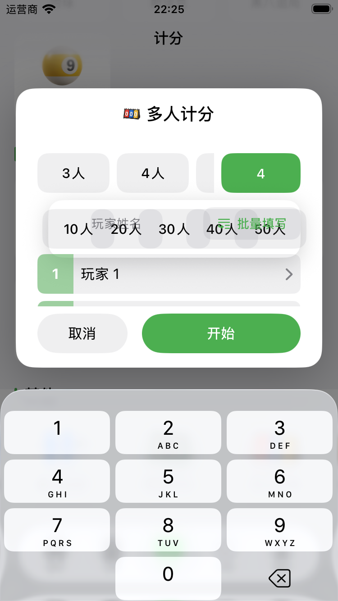
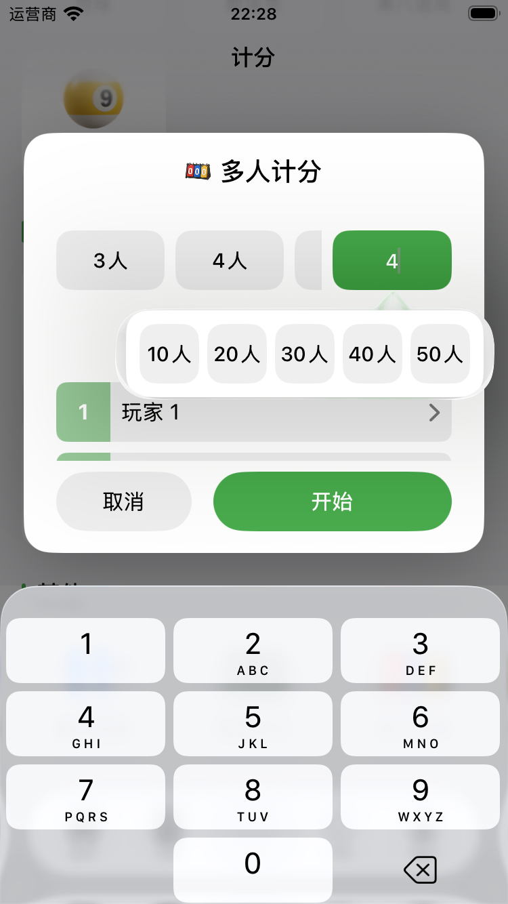
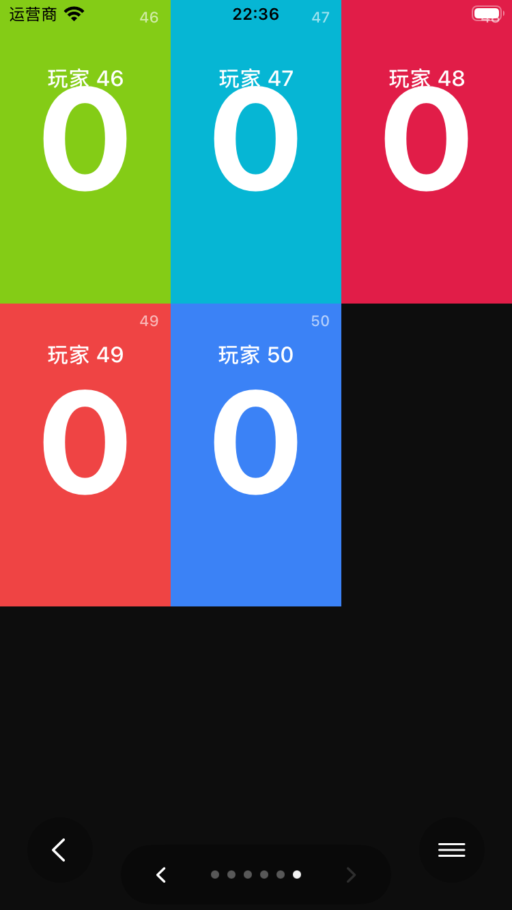
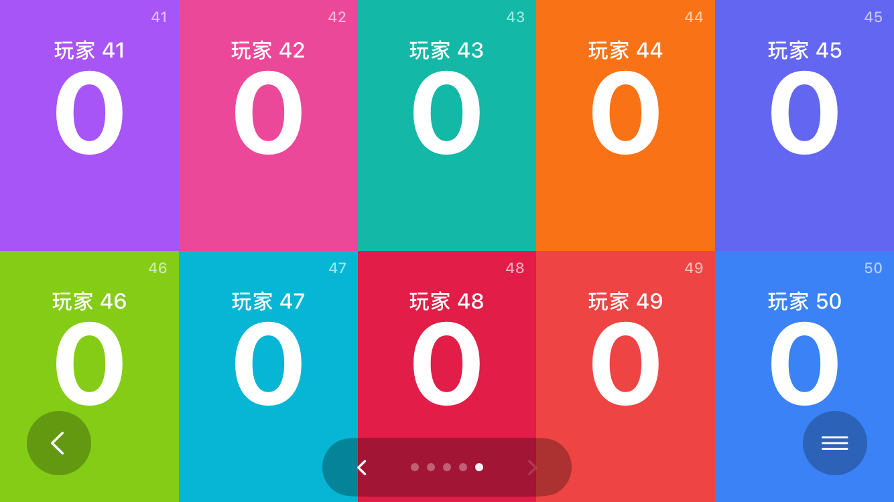
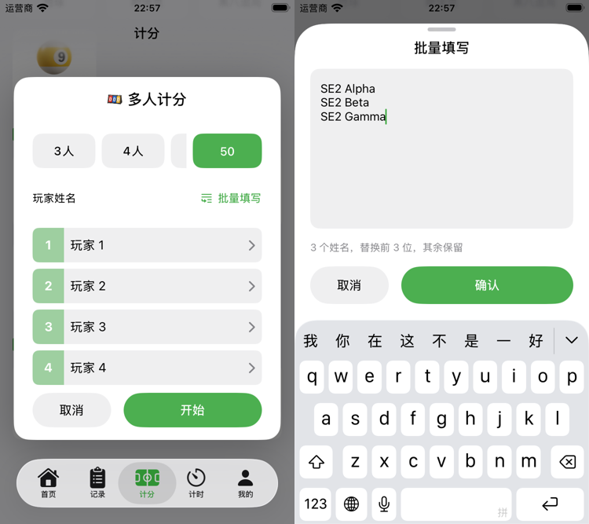
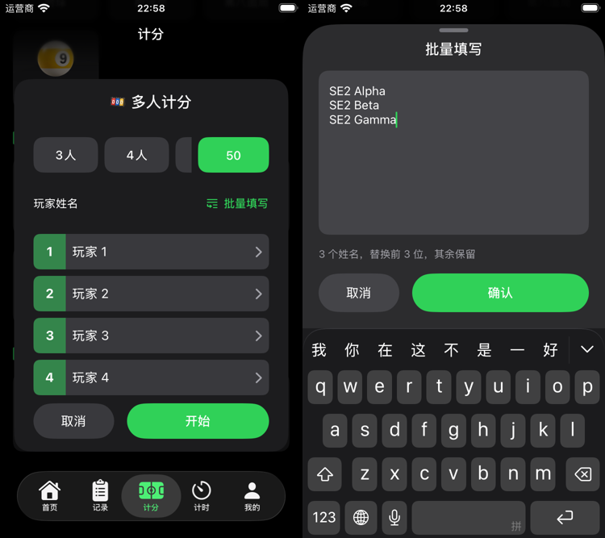
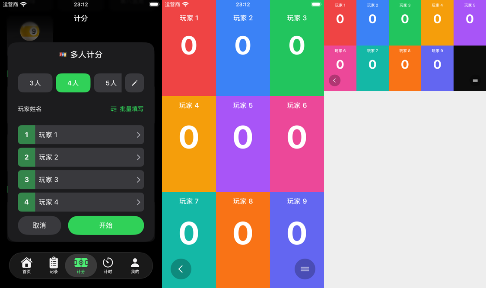
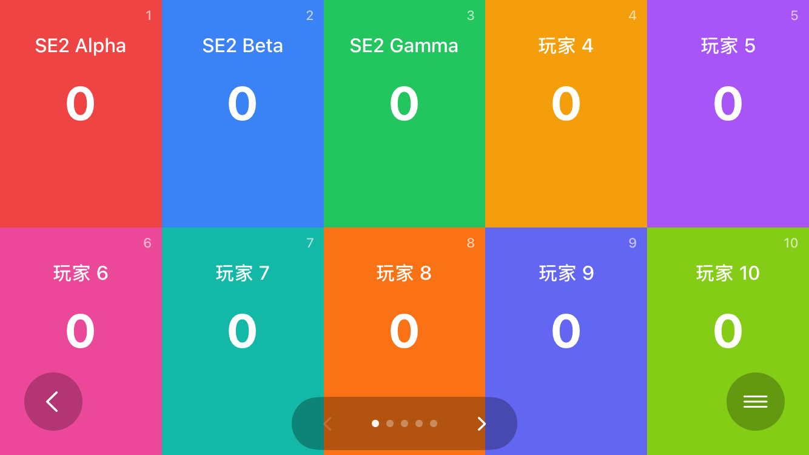
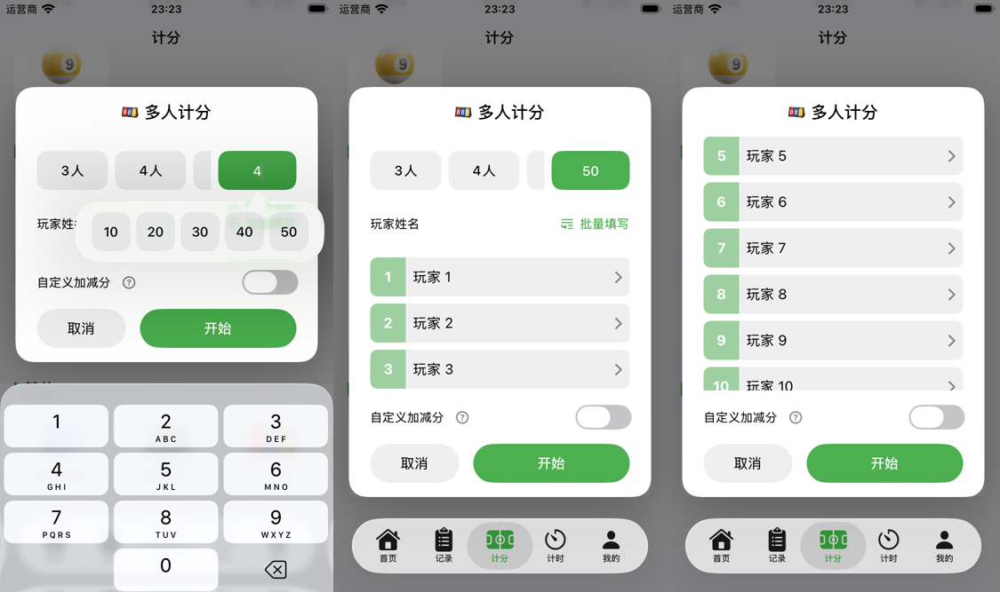

# iPhone SE 2 回归（2026-10-30）

实机已连接，最新 Debug 测试版已安装。真机定向单测通过；真机 UI Runner 初始化失败后，按用户指定的备选方案使用 SE 2 模拟器完成交互回归。

| 环境 | 结果 | 覆盖范围 |
| --- | --- | --- |
| iPhone SE（第 2 代），iOS 27.0.1 | 56 通过，0 失败，0 跳过 | 人数/姓名解析、分页与分数净空、投屏生产根视图只改锚点刷新、预约篮球保存与摘要、匹克球目标分、偏好清理 |
| 同一真机 UI 自动化 | Runner 初始化失败，未执行用例 | `Timed out while enabling automation mode.`，不能据此声称真机触控通过 |
| SE 2 模拟器，iOS 26.5，375×667pt | 3 个 UI 用例通过，0 失败 | 50 人设置/批量填名/翻到末页，篮球编辑时长并重置至 20:00，预约自定义每节 24 分钟输入 |
| 同一模拟器补强回归 | 多人 UI 用例重跑通过 | 通过应用菜单切换布局，断言应用宽高方向确实变化，末页锚点保留且上一页可用 |

真机执行的六个测试类为 `MultiScoreSetupControlsTests`、`MultiScorePagingTests`、`MultiScoreDisplayPagingTests`、`BookingBasketballTimingTests`、`PickleballTargetScoreSetupTests`、`LocalDataResetCoordinatorTests`。`LocalizationIntegrityTests` 读取 Mac 源码路径，未放入真机选择；其模拟器 93 项验证见主对齐文档。

## 测试发现与修复

自定义人数的原浮层使用行内 overlay，覆盖“玩家姓名 / 批量填写”行；五个按钮各有 80pt 最小宽度，超出 280pt 浮层。父层 accessibility identifier 还覆盖了按钮标识，自动化无法准确选择 50 人。

改为锚定输入框的系统 popover，紧凑设备保持 popover；五个选项各使用 44pt 最小宽度并保留各自标识。修复后的 50 人选择、关闭浮层、批量填名和开局均由 UI 用例实际点击通过。

| 修复前 | 修复后 |
| --- | --- |
|  |  |

| 末页竖屏 | 切换后横屏 |
| --- | --- |
|  |  |

其他选定截图：[预约 24 分钟](booking-custom.png)、[重置目标 20:00](basketball-reset-target.png)、[重置后时钟](basketball-reset-applied.png)。

## 执行及证据

沿用 `/Users/yangyang/Library/Developer/Xcode/DerivedData/jifen-ios`。工程默认测试签名关闭，第一次真机单测无法加载未签名的测试 bundle；命令增加 `CODE_SIGNING_ALLOWED=YES -allowProvisioningUpdates` 后通过，未修改工程签名配置。最终生产浮层修复后再次在真机运行 56 项，仍全部通过。

三条交互入口位于 `FullAppScreenshotUITests`：`testSE2MultiScoreFiftyPlayerPagingRegression`、`testSE2BasketballEditedClockTargetRegression`、`testSE2BookingBasketballCustomFieldsRegression`。不清空用户数据，不保存测试预约。未执行物理电视 / AirPlay 连接、实机触控验收或正式包归档、导出、上传。

原始证据批次：`~/Library/Developer/jifen-ios-test-artifacts/runs/20261030T141211039802Z-se2-device-regression-20261030/`。

- `device-final.xcresult`、`device-final-summary.json`：最新代码真机 56 项通过。
- `device-ui.xcresult`、`device-ui.log`：真机 UI 自动化启用超时，保留排障。
- `se2-ui-final.xcresult`、`se2-ui-summary.json`：三组模拟器交互通过。
- `se2-rotation-final.xcresult`、`se2-rotation-final-summary.json`：补强真实布局切换断言后重跑通过。

外部原始证据受保留期管理、可能到期清理；本批因未解决的真机 UI Runner 初始化问题使用 `.keep` 固定，待该问题解决后再解除。已删除被最终结果替代的中间 xcresult 和重复导出截图；本目录仅保存必要的选定截图与结论。

## 手测反馈：姓名标题与批量输入样式

- 批量填写的 `TextEditor` 隐藏系统自带底色，仅保留一层对话框控件背景，消除灰框内嵌白框的效果。
- “玩家姓名”改为姓名输入组左侧标题；与“自定义加减分”统一为 14pt、常规字重、主文字色。“批量填写”在右侧显示为无背景的图标文字入口，保留 44pt 点击高度。
- 复用现有多人 UI 回归，在 SE 2 模拟器浅色、深色外观各运行一次，均通过。截图核对标题位置、入口背景及输入框底色；本次没有新增仅验证样式实现细节的单测。

| 浅色：标题与输入框 | 深色：标题与输入框 |
| --- | --- |
|  |  |

本次原始证据独立批次：`~/Library/Developer/jifen-ios-test-artifacts/runs/20261030T145553740748Z-multi-name-style-20261030/`（`light.xcresult`、`dark.xcresult` 及真机签名构建日志），按正常保留期到期清理。此处仅保留选定截图拼图。

## 追加反馈：铅笔入口与计分板姓名间距

- 人数行右侧去掉可见“自定义”文字，仅显示 44×44pt 铅笔入口，保留辅助功能名称；进入后仍可输入人数或选择常用人数。
- 用户确认“数字与名字靠在一起”指计分板的大分数与玩家姓名。旧实现中姓名与分数叠在同一 `ZStack`，分数按完整格子居中，没有保证姓名以下的间隔。多人板改为上下分区，姓名独占顶部一行，分数在其下方剩余区域居中，至少间隔 8pt；字号预算包含实际顶部安全区、姓名和底部控件净空，空间不足时缩小分数字号。UNO 继续使用原有布局。
- 最终 SE 2 模拟器回归 **10 项通过，0 失败、0 跳过**：9 个分页/字号单测，加 1 个完整 UI 用例。UI 用例实际经过 9 人横竖屏、铅笔人数入口、50 人与批量姓名、翻至末页及布局切换；选定截图人工核对间距和底部按钮避让。
- 当前签名 Debug 构建成功，覆盖安装到连接的 SE 2，保留原有数据。版本号仍为 3.4.1（84）；未生成正式 IPA。

横屏选定截图仅旋正 XCTest 返回的位图方向，未改动画面内容。最终证据为同批 `final.xcresult`、`final-summary.json`、`device-ready-build.xcresult` 与安装日志；被替代的中间构建和回归包已清理。

## 追加反馈：人数浮层与固定底部开关

- 移除人数 popover 内容额外添加的圆角实色背景及阴影，仅使用系统弹出层。常用人数的可见文字在所有语言下均为 `10 / 20 / 30 / 40 / 50`；辅助功能仍朗读本地化人数。3～9 人的主行快捷项保持原文案。
- 多人设置的“自定义加减分”移到固定操作区，在取消 / 开始按钮上方始终可见。操作区使用对话框背景，姓名区域单独滚动；共用容器按实际操作区高度分配可滚动空间，最后的姓名也能滚动到可编辑区域。简单计分原有表单位置不变。
- SE 2 模拟器完整 UI 用例通过，0 失败、0 跳过。新增行为断言确认 50 人名单确实向上滚动，同时开关保持可点击，纵坐标变化不超过 2pt；批量填名、开局、分页及布局切换仍通过。截图已检查。
- 当前签名 Debug 构建及签名校验通过，已覆盖安装并打开连接的 SE 2，保留用户数据。

本次外部批次：`~/Library/Developer/jifen-ios-test-artifacts/runs/20261030T152125955719Z-multi-popover-footer-20261030/`，包含 `ui.xcresult`、测试汇总与真机签名构建 / 安装日志，按正常保留期到期清理；仓库仅保留本节选定截图拼图。
